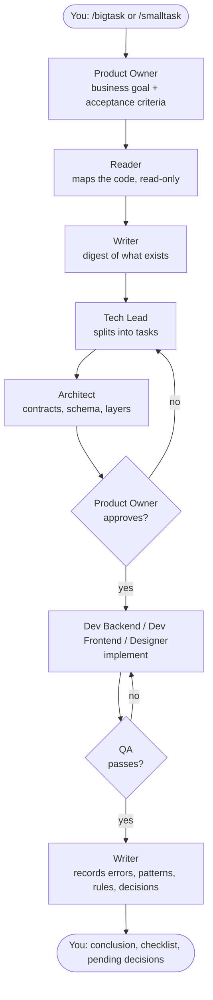

<div align="center">

# Nirvana

**Turn Claude Code into a 9-role dev team that plans, builds, tests — and remembers.**

[](https://github.com/AndrausP/nirvana/actions/workflows/ci.yml)
[](LICENSE)
[](https://claude.ai/code)


[Quickstart](#quickstart) · [How it works](#how-it-works) · [Commands](#commands) · [Docs](#documentation) · [Contributing](CONTRIBUTING.md)

</div>

---

You type `/bigtask add password reset by email`. Nirvana asks for the business rule, grills
your design, then hands the work down a chain — **Product Owner → Tech Lead → Architect → Devs →
QA → Writer** — where every role has exactly one job. When it's done, the Writer records what
the team decided and learned in your repo, so the next session (and your teammates) pick up where
this one stopped.

Works with **any project and any stack**: Nirvana is a set of Claude Code skills plus markdown
files in your repo. No server, no SDK, no new tool to learn.

## Why Nirvana

- **One job per agent.** The Product Owner decides and never codes. The Reader only reads. The
  Writer is the only one allowed to write memory. Roles don't overlap, so work doesn't skip steps.
- **Memory that outlives the session.** Root causes of bugs, project patterns, business rules
  and architecture decisions go to `docs/knowledge/`, indexed by
  [graphify](https://github.com/Graphify-Labs/graphify). You stop re-explaining the project.
- **The plan lives in your repo.** Sprints and tasks are markdown files under `docs/` —
  reviewable in pull requests, readable without Nirvana.
- **Business rules that stick.** `/law payment requires a verified user` — the Product Owner
  checks every future task against it.
- **QA before "done".** Every chain ends in a QA step; a failure goes back to the developer role,
  not forward to you.
- **Respects your setup.** `/light` merges a block into your existing `CLAUDE.md` between markers
  and merges its hook into `.claude/settings.json`. It shows the plan and asks before it writes.
- **Tested on every OS.** Installers and hooks run in CI on Windows PowerShell 5.1, macOS and
  Linux.

## Quickstart

**1. Install once per machine**

```powershell
# Windows (PowerShell)
iwr -useb https://raw.githubusercontent.com/AndrausP/nirvana/main/install.ps1 | iex
```

```bash
# macOS / Linux
curl -fsSL https://raw.githubusercontent.com/AndrausP/nirvana/main/install.sh | bash
```

**2. Set up a project** — open Claude Code in it and run:

```
/light
```

**3. Give the team work:**

```
/bigtask add password reset by email
/smalltask fix null check in UserService
```

From then on, every time you open the project a banner shows where things stand:

```
+----------------------------------------+
  N I R V A N A
+----------------------------------------+
  Sprint:  sprint-1
  Tasks:   1 planned / 1 in-progress / 3 done
  Sync:    2/5 sessoes desde o ultimo /reflect
  Cadeia:  PO -> Reader -> Writer -> Tech Lead -> Architect -> Tech Lead -> PO -> Devs -> QA -> Writer -> Broker
  Chat da cadeia: hidden  (ligar so nessa run: /chat)
+----------------------------------------+
```

## How it works



| Role | Model | Its one job |
|------|-------|-------------|
| Product Owner | opus | Decides and approves. Never implements. |
| Tech Lead | opus | Breaks work into tasks, decides technical viability. |
| Architect | sonnet | Designs structure: contracts, schema, layers. |
| Dev Backend / Dev Frontend | sonnet | Implement, specialized in your detected stack. |
| Designer | sonnet | UX/UI flows and visual guidelines. |
| QA | sonnet | Tests against the acceptance criteria. |
| Reader | haiku | Reads the project. Never writes, never decides. |
| Writer | sonnet | The only role that writes memory. |

Today the chain runs inside your main Claude Code session, so the model column is each role's
intended tier; running roles as real subagents on their own model is on the roadmap. Add `/chat`
to any task to watch the hand-offs live. Full walkthrough: [How it works](docs/guide/how-it-works.md).

## Commands

| Command | What it does |
|---------|--------------|
| `/light` | Set up Nirvana in the current project. Re-run to update it. |
| `/bigtask <description>` | Features and refactors: business rule first, design grilling, full chain. |
| `/smalltask <description>` | Clear, small tasks: full chain, no interview. |
| `/law <rule>` | Record a business rule the Product Owner enforces from now on. |
| `/reflect` | Rebuild `docs/` from the knowledge base. Also runs every N sessions. |
| `/karma` | Status: agents, sessions, docs, graphify, open sprints and tasks. |
| `/path` | Show the project's Nirvana settings. |

Examples and flags: [Commands](docs/guide/commands.md).

## Nirvana vs. plain Claude Code

| | Plain Claude Code | With Nirvana |
|---|---|---|
| Before coding | Whatever the prompt says | Acceptance criteria, task breakdown and an approved design |
| Between sessions | A `CLAUDE.md` you maintain by hand | Writer records errors, patterns, rules and decisions |
| Tracking work | In your head or another tool | `docs/sprints/` and `docs/tasks/` in the repo |
| Business rules | Repeated in prompts | `/law`, checked on every task |
| Testing | When you remember to ask | QA step in every chain |
| Long sessions | Default auto-compaction | Your threshold, and the Writer saves what the summary would lose |

**When not to use it:** a full chain costs more tokens than a single prompt. For one-line fixes
use `/smalltask`, or plain Claude Code.

## Requirements

- [Claude Code](https://claude.ai/code), installed and signed in
- PowerShell 5.1+ (Windows) or bash (macOS / Linux)
- Optional: [graphify](https://github.com/Graphify-Labs/graphify) (`pip install graphifyy`) for
  the knowledge graph. Without it the Writer keeps the same markdown files, just without a graph
  index.

Update with `update.ps1` / `update.sh`, the same way you installed. Details, uninstalling and the
full `state.json` reference: [Configuration](docs/guide/configuration.md).

## Documentation

- [How it works](docs/guide/how-it-works.md) — the chain step by step, memory, sprints and tasks
- [Commands](docs/guide/commands.md) — every command with examples and flags
- [Configuration](docs/guide/configuration.md) — install, update, uninstall, compaction, `state.json`
- [Changelog](CHANGELOG.md)

This repo runs Nirvana on itself: its own `CLAUDE.md`, `docs/` and `.claude/` are a live example
of what `/light` produces.

## Contributing

Issues and pull requests are welcome — see [CONTRIBUTING.md](CONTRIBUTING.md) for how to run the
tests locally. If Nirvana saves you time, a ⭐ helps other Claude Code users find it.

## License

[MIT](LICENSE)
